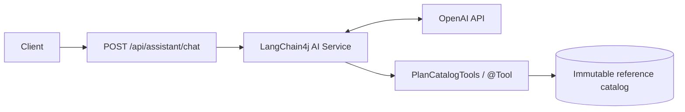

# Quarkus + LangChain4j | Tool-calling AI Agent

**Java 21 · Quarkus · LangChain4j · LLM tool calling · Conversation memory · Metrics**

A realistic AI integration demo: instead of asking an LLM to invent pricing, an AI service calls a **deterministic Java catalog tool**. The LLM handles language; Java owns the business rules.

## Architecture



## Highlights

- `@RegisterAiService` with typed `@UserMessage` and session-scoped `@MemoryId`.
- Explicit tool-calling via `@ToolBox`; catalog data is **not inferred from prompts**.
- Bounded input and separate conversation identifiers.
- Micrometer/Prometheus metrics + health endpoint.
- Unit tests run **without an API key** and never make paid API calls.

## Run

Requirements: JDK 21, Maven 3.9+, OpenAI API key.

```bash
export OPENAI_API_KEY='your-key'  # PowerShell: $env:OPENAI_API_KEY='your-key'
mvn quarkus:dev
```

```bash
curl -X POST http://localhost:8080/api/assistant/chat \
  -H 'Content-Type: application/json' \
  -d '{"conversationId":"local-demo-1","message":"How much is the Team plan?"}'
```

Run local deterministic tests with `mvn verify`. Check `/q/health` and `/q/metrics`.

## Design decisions / limitations

- **This is tool calling, not RAG**: there is no embedding store or vector search. It intentionally demonstrates LLM orchestration while keeping pricing deterministic.
- The catalog is fictional; no real customer information belongs in prompts.
- This demonstration has no authentication, durable conversation memory, quotas, or abuse throttling. Add these before public deployment.
- The `conversationId` is caller-provided: for production, bind it to an authenticated user/tenant to avoid cross-user memory access.
- LLM outputs should be treated as untrusted; always validate any business action outside the model.
- Real requests use an external AI provider and can incur cost; CI does not call the provider.

## Next steps

Add retrieval from a vetted knowledge base, persistent tenant-scoped memory, token/cost tracking, and eval-driven regression tests.

_Independent portfolio demonstration. Not affiliated with any employer or customer._
